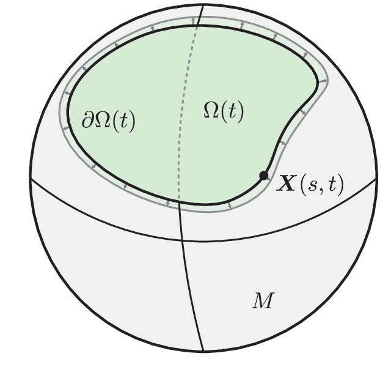

<p align="center">
  <picture>
    <source media="(prefers-color-scheme: dark)" srcset="docs/assets/fig1-dark.png">
    
  </picture>
</p>

# Geometric regulation of stress-limited growth on surfaces

**Abstract:** We analyze a model for microbial communities growing on surfaces in which individual growth is inhibited by collective growth-induced pressure. Asymptotic and numerical solutions on the sphere and homogenization of periodic surfaces show surface geometry can be tuned to either slow or accelerate growth. We use these insights to identify classes of surfaces for which the growth rate can be made arbitrarily small or arbitrarily close to the stress-free growth rate. These results show stress-sensing is coupled to surface curvature and topography at scales much larger than the individual, and provide design principles for controlling the growth of stress-sensitive microbial communities.

The model, results, and interactive figures are included at the **[project page](https://scottweady.github.io/surface-growth/)**. The full text is available on **[arxiv](https://arxiv.org/abs/2611.14159)**.

## Reproducibility

All data and figures in the manuscript can be generated directly from this repository. Numerical validation is provided in the test suite. To execute this, from the repository root in MATLAB:

```matlab
setup                          % add src/ and utils/ to the path

cd data,  makedata, cd ..      % solve and save figure data (skips existing .mat files)
cd figs,  makefigs, cd ..      % write figs/output/fig2.pdf ... fig6.pdf
cd test,  runtests, cd ..      % convergence studies, written to test/output/
```

The precomputed data in `data/` is already committed, so `makefigs` can be run directly without re-solving. To force a re-solve, delete the corresponding `.mat` file before running `makedata`.

Running `makedata` and `runtests` requires

- MATLAB
- [chebfun](https://www.chebfun.org/): see the site for installation instructions.
- [surfacefun](https://github.com/scottweady/surfacefun) (fork of danfortunato/surfacefun): clone it and add it to your MATLAB path.

Both must be on the MATLAB path before running anything in this repo. Run `setup.m` to add this repo's own `utils` and `src` folders to the path.

## Layout

- `src/`: core solvers
  - `growth`: surface-sensing growth flow on a general `surfacemesh`, optionally anisotropic
  - `growthHomogenized`: homogenized problem on a disk (polar spectral discretization)
  - `growthSphere`: axisymmetric growth on a spherical cap
  - `roughnessTensor`: effective tensor $K$ and area element $J$ of a periodic rough surface
- `scripts/`: higher-level simulations built on `src/`
  - `growthEvolve`: moving-boundary growth on a flat or homogenized surface
  - `sphereProfiles`, `sphereGrowth`, `sphereGrowthRate`: spherical-cap growth
  - `roughnessGrowthRate`, `movingBoundaryRoughness`: roughness homogenization
  - `planarStability`: linear stability of the growing disk to non-axisymmetric perturbations, checked against the 2D solver
  - `planarStabilitySymbolic`: symbolic derivation of the same dispersion relation (Appendix A)
- `data/`: figure data. `data/makedata.m` runs the `scripts/` solves and saves their output as `fig2.mat`, ..., `fig6/isotropic.mat`, `fig6/anisotropic.mat`.
- `figs/`: figure scripts, run via `figs/makefigs.m`. Each `figN.m` loads its precomputed data from `data/`.
- `test/`: convergence studies, run via `test/runtests.m`
- `utils/`: shared plotting and numerical helpers
- `docs/`: the project page (`index.html`), its interactive figures and data (`assets/`), and the scripts that generate them (`makeinteractive.m`, `makeschematic.py`)
